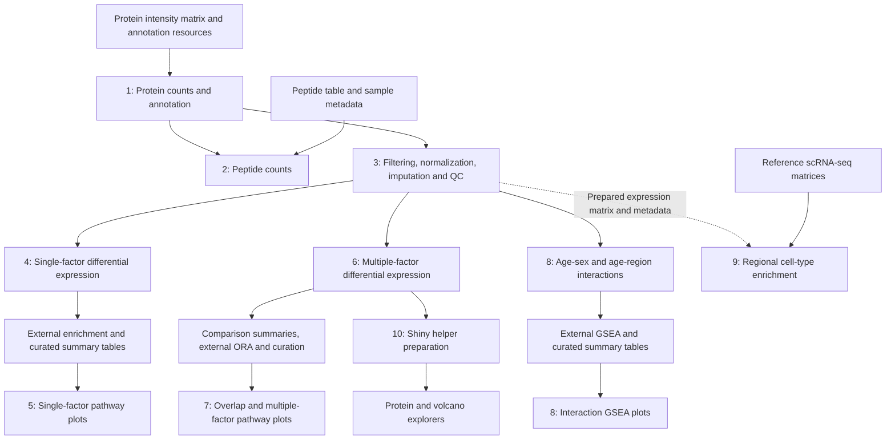

# Rat lung proteomics analysis

Code, processed tables and figure outputs accompanying the rat lung proteomics manuscript. **Scripts 1–10 are now represented in this repository.** This is a working manuscript-revision archive, not yet a validated end-to-end release.

The folders preserve the authors' existing analysis organization. Each folder contains its own inputs, scripts and saved outputs; they are not a single automatically chained pipeline. Some enrichment results and plotting tables were prepared externally or curated manually.

## Workflow and execution order



Solid arrows describe intended data handoffs, not automatic file copying. The Script 9 expression workbook is supplied separately; its exact conversion from preprocessing output is not scripted here. Script 2 is a coverage-count branch and is not a prerequisite for modeling.

## Module inputs and outputs

| Module | Main inputs | Processing and principal outputs | Downstream use |
|---|---|---|---|
| [Script 1](Script_1_protein_number_count/) | `report.pg_matrix.tsv`; UniProt annotation `.RData`; external matrisome annotation; `Sample_index.xlsx` | Protein ID mapping and per-sample counts. Writes `Matrisome_annotation_input.xlsx`, `Protein_counts_summary.xlsx` and `expression_matrix.rds`. The returned external annotation is read as `Matrisome_annotation_output.xlsx`. | Count workbook → 2 and 3; expression matrix → 3. |
| [Script 2](Script_2_peptide_number_count/) | `Peptide.xlsx`; `Protein_counts_summary.xlsx` / `Raw_table_annotation`; `Sample_metadata.xlsx` | Maps peptide entries to protein/matrisome annotations and exports `Peptide_counts_summary.xlsx`. | Protein/peptide coverage summaries; no direct input to DE models. |
| [Script 3](Script_3_data_preprocessing/) | `expression_matrix.rds`; `Protein_counts_summary.xlsx`; `Sample_metadata.xlsx` | Filtering, log2 transformation, median normalization, random-forest/QRILC imputation, QC/PCA. Exports observed-value counts, annotated intensity workbook, processed data tables and workspace. | Processed log2 matrix, annotations and metadata → 4, 6, 8; prepared expression data support 9. |
| [Script 4](Script_4_single_factor_DE/) | Saved processed data tables; annotated intensity workbook / `data_imp`; sample metadata and index | Single-factor DE tables in `Single_factor_DEP_summary.xlsx`; volcano, DEP count and matrisome heatmap PDFs; `Single_factor_DEP_summary_data_summary.RData`. | DE results → external ORA/GSEA summary preparation → 5. |
| [Script 5](Script_5_single_factor_pathway/) | Precomputed `ORA_summary.xlsx`, age/sex GSEA summaries and regional GSEA workbooks in the respective subfolders | Plots selected GO and Reactome enrichment terms; exports age, sex and region pathway PDFs. These scripts read enrichment results rather than perform all upstream enrichment tests. | Manuscript pathway figures. |
| [Script 6](Script_6_multiple_factor_DE/) | Processed data tables; annotated intensity workbook; `Sample_metadata.xlsx`; `Real_values_number_in_sample_group.xlsx` | Method 4 mixed-model contrasts. Writes `age.vs.young4.xlsx`, `female.vs.male4.xlsx`, `region.vs.region4.xlsx`, DEP summaries, volcano/boxplot/correlation PDFs and `Script_6_multiple_factor_DE.RData`. | Results → 7 after table preparation; saved workspace → 10. |
| [Script 7](Script_7_mulltiple_factor_pathway/) | `age vs young/summary_table3.xlsx`; `ORA summary on sex.xlsx`; `ORA summary on region.xlsx`; female/male eight-group workbook; S8 ORA workbook | UpSet figures, exact-intersection and group protein lists, and curated ORA plots. Includes S8, S10, S11, S18/S19 and main Figure 5 ORA plotting sections. | Figure panels and exported protein sets; some Venn assembly is manual. |
| [Script 8](Script_8_multiple_factor_age%3Asex_and_age%3Aregion_interaction/) | Same processed matrix, annotations, observed-value counts and sample metadata used for multiple-factor analysis; `GSEA/gsea summary.xlsx` | Age-by-sex and age-by-region interaction tables and volcano PDFs; separate script plots curated interaction GSEA summaries. | Interaction figures and enrichment interpretation. |
| [Script 9](Script_9_region_cell_type_enrichment_with_scRNAseq/) | Male/female reference scRNA-seq MTX, genes and barcodes (`GSM3926541`, `GSM3926542`); `expression matrix.xlsx`; `sample metadata.xlsx` | Two branches: regional protein enrichment in scRNA-seq cell types; and cell-type marker scores across proteomic regions. Exports marker CSVs, region-specific protein workbooks, regional score-model CSVs and plot objects. Several PDF files are supplied but are not automatically exported by the current scripts. | Cell-type interpretation and associated figures. |
| [Script 10](Script_10_R_Shiny/) | `Script_6_multiple_factor_DE.RData` from 6 | Preparation script writes age/sex/region protein-explorer helpers and volcano comparison-list helper. Two app folders contain their own copies and `app.R`. | Interactive exploration and downloadable results. |

## Concrete handoffs between folders

| Producer | File / object | Consumer and action |
|---|---|---|
| 1 | `Protein_counts_summary.xlsx`, sheet `Raw_table_annotation` | Copy to 2 and 3. Existing workbook copies are supplied. |
| 1 | `expression_matrix.rds` | Copy to 3 after generation. This file is currently absent from the supplied folders. |
| 3 | `UW.Madison.rat.lung.proteomics_data tables_<date>.RData` | Copy to 4, 6 and 8. Contains `data_table`, annotations and sample information; DE scripts use `data_table$data_imp`. |
| 3 | `UW.Madison.rat.lung.proteomics_DIANN_protein intensity_<date>.xlsx` | Copy to 4, 6 and 8; annotation columns are read from `data_imp`. |
| 3 | `Real_values_number_in_sample_group.xlsx` | Copy to 6 and 8 for observed-value eligibility. Counts precede imputation. |
| 4 | `Single_factor_DEP_summary.xlsx` | Source for single-factor result exploration and external enrichment input preparation. The curated tables in 5 are a separate handoff, not automatic output of 4. |
| 6 | Three Method 4 comparison workbooks and age summary objects | Prepare/copy the comparison-summary and curated ORA inputs expected by 7. The supplied Script 7 workbooks should not be assumed to regenerate automatically when 6 is run. |
| 6 | `Script_6_multiple_factor_DE.RData` | Copy to 10 before running `Script-10_R_Shiny.R`. |
| 8 | Interaction result workbooks | External enrichment and curation → `GSEA/gsea summary.xlsx` → interaction pathway plots. |
| 10 | `helper age.RData`, `helper sex.RData`, `helper region.RData` | Copy into `apps/protein_explorer/`. |
| 10 | `helper volcano plot.RData` | Copy into `apps/volcano_explorer/`. |

The archived preprocessing outputs use **2026-09-15** filenames. Script 3 generates names using `Sys.Date()`, while downstream scripts currently read fixed filenames. Update the downstream references or deliberately preserve the chosen snapshot filenames when rerunning; do not mix outputs from different runs.

Sample metadata filenames differ across modules (`Sample_index.xlsx`, `Sample_metadata.xlsx`, and `sample metadata.xlsx`). Use the file expected by the relevant script. Sample order and protein-ID alignment must be preserved across expression data, annotations and metadata.

## Running the analysis

1. Open the required R script in RStudio and use its directory as the working directory. Most scripts use `rstudioapi::getSourceEditorContext()`; these lines need adapting for unattended `Rscript` execution. Some scripts assume an already configured working directory.
2. Resolve the input requirements listed below before starting a full rerun. The included processed snapshots allow inspection of later stages without rerunning imputation.
3. Follow the branches in the workflow diagram. Perform the documented external annotation/enrichment and curation steps before running the corresponding plotting modules.
4. A script may write into the same directory as its archived outputs. Use a separate working copy if retaining the archived results for comparison.

The Shiny applications can be launched independently from the repository root:

```r
install.packages(c("shiny", "ggplot2", "DT", "dplyr", "tidyr", "ggtext"))
shiny::runApp("Script_10_R_Shiny/apps/protein_explorer")
# Stop the first application before launching the second.
shiny::runApp("Script_10_R_Shiny/apps/volcano_explorer")
```

See [the Shiny README](Script_10_R_Shiny/README.md) for data versions, comparisons, thresholds and downloads. Its `sessionInfo.txt` records the local Shiny/preparation environment, not a validated environment for every Script 1–9 dependency. No full-project `renv.lock` is supplied yet.

## Reproducibility status and known gaps

The scripts were copied without changing analysis code. Static parsing is not an end-to-end execution test. See [syntax results](docs/SYNTAX_CHECK.md), the [file-I/O source index](docs/FILE_IO_INDEX.md), and [missing literal input paths](docs/MISSING_INPUTS.md).

- **Script 1:** its referenced DIA-NN matrix, UniProt annotation workspace and externally returned annotation filename are absent from its supplied directory. `Matrisome_annotation_table.xlsx` is present, but it has not been asserted equivalent to the missing files. `import()` is used without loading `rio`. The `!!!` immediately before `tables_list <- list(...)` is executable R syntax, not a comment, and needs review before running this section.
- **Script 3:** `expression_matrix.rds` is absent, and the PCA section sources `ggbiplot.r` from a machine-specific `T:/...` path. The original imputation did not set a random seed; use the archived imputed outputs for the fixed downstream snapshot. A rerun may differ numerically.
- **Script 4:** some later sections still read `DE summary1.xlsx` instead of the earlier `Single_factor_DEP_summary.xlsx` export. Check the missing-input report before execution.
- **Scripts 5, 7 and interaction GSEA in 8:** input workbooks include precomputed or manually curated enrichment results. Do not describe these plotting scripts as a fully automated enrichment pipeline. Some final figure assembly and Venn diagrams were performed separately.
- **Script 7:** comparison workbooks such as `summary_table3.xlsx` are supplied intermediates; the full export/curation link from Script 6 is not automated in the current files.
- **Script 9:** `region_protein_marker_in_scRNAseq _cell_type.R` has pasted console `+` prompts near line 1174 and currently fails parsing. The other Script 9 branch parses. The supplied input tables and reference matrices are included, but both branches still need execution review.
- **Portability:** several Script 8 names contain `:` and some plot filenames contain `<` or `>`. These existing names were preserved; Windows-compatible naming remains to be addressed before a cross-platform release.

Age labels vary between annotations: many scripts use “Aged”/“Young”, while Script 3 notes A = young adult and Y = peripubertal. Interpret these labels using the manuscript and sample metadata; biological labels have not been rewritten during archiving.

## Included data and large-file handling

The repository includes the available smaller input tables, reference count matrices, intermediate results and figure files alongside the scripts. The [added-file manifest](docs/added_files_manifest.csv) records file sizes and SHA-256 checksums for Scripts 1–9.

Two Script 9 saved workspaces, approximately 764 MB and 761 MB, were **not uploaded**. Their scripts do not load these snapshots directly; their reference matrices and smaller supporting inputs are included. Original files remain in the authors' local working directories. Exact paths, sizes and checksums are in [the large-file manifest](docs/large_files_not_in_git.csv). Separate archival deposition is pending; the manifest is not a download link. GitHub blocks ordinary Git files larger than 100 MiB ([GitHub documentation](https://docs.github.com/en/repositories/working-with-files/managing-large-files/about-large-files-on-github)).

Local histories, operating-system files, Excel lock files and `rsconnect` deployment records are excluded. Script folders retain existing names and are separate from the authors' working copies.

## Hosted applications

- https://feiwang-outobi.shinyapps.io/DEP-volcano-plot3/
- https://feiwang-outobi.shinyapps.io/Protein-combined-analysis3/

The authors reported completing deployment of the current applications. Hosted behavior has not been independently revalidated as part of this repository update.

## Release, citation and license

The planned manuscript release is `v1.0.0`, after the remaining input gaps, execution checks and documentation have been resolved. No release or Zenodo DOI has been issued. Citation metadata and code/data reuse terms will be added before public release; no license grant is implied at this stage.
