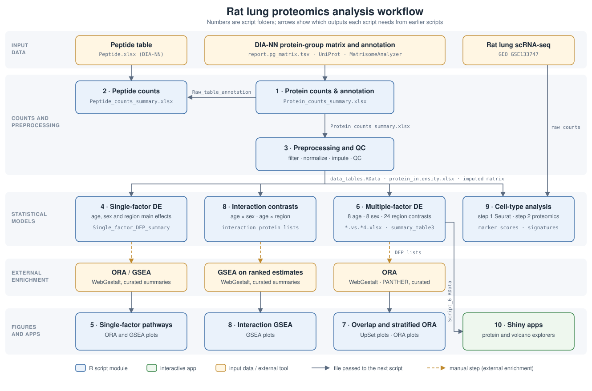

# Rat lung proteomics: age, sex and regional variation

Analysis scripts, supporting data, pathway summaries and figures for the rat lung proteomics study. The repository covers protein/peptide detection, preprocessing, differential expression, pathway enrichment, age-by-sex and age-by-region interactions, cell-type interpretation and Shiny applications.

This is a manuscript analysis archive, not a single-command pipeline. Each numbered folder retains its own inputs and outputs, and every script starts with a header describing its purpose, inputs, outputs and the figures it produces. External annotation, enrichment and manual curation are separate steps.

## Sample terminology

- **Y / Young:** 7-week-old rats (7w); **A / Aged:** 7-11-month-old rats (7-11m).
- **F / M:** female / male.
- **B / C / P / T:** bottom / central / peripheral / top lung region.
- Sample-group codes are written age–region–sex, e.g. `ABF` = 7-11m, bottom, female; `YBF` = 7w, bottom, female. Filenames, model labels and the Shiny apps use `Young` / `Aged`; the supplementary tables use `7w` / `7-11m`.

## Workflow



Arrows describe data dependencies, not automatic file transfer. Script 2 is a coverage-summary branch, not a prerequisite for modeling. Script 9 uses the processed proteomics matrix plus the public rat lung scRNA-seq reference (GEO GSE133747).

## Scripts and outputs

| Module | Purpose and principal files |
|---|---|
| [1 — Protein counts and annotation](Script_1_protein_number_count/) | `Script_1_protein_number_counts.R` reads the DIA-NN protein-group matrix, UniProt annotations and sample index. External matrisome annotation (MatrisomeAnalyzer) supplies `Matrisome_annotation_output.xlsx`. Outputs `Protein_counts_summary.xlsx` (count sheets + `Raw_table_annotation`) and `Matrisome_annotation_table.xlsx`. |
| [2 — Peptide counts](Script_2_peptide_number_count/) | `Script_2_peptide_number_count.R` combines `Peptide.xlsx`, protein annotations and sample metadata to generate `Peptide_counts_summary.xlsx`. |
| [3 — Preprocessing and QC](Script_3_data_preprocessing/) | `Script_3_data_preprocessing.R` reads `Raw_table_annotation` and sample metadata, filters (≥ 48/96 samples or ≥ 5/6 in any group; 3,600 proteins), log2-transforms, median-normalizes, imputes (random forest, then QRILC for group-wise absence) and draws QC/PCA plots. Exports `UW.Madison.rat.lung.proteomics_data_tables.RData`, `UW.Madison.rat.lung.proteomics_DIANN_protein_intensity.xlsx`, `Real_values_number_in_sample_group.xlsx`, QC and PCA PDFs. |
| [4 — Single-factor comparisons](Script_4_single_factor_DE/) | `Script_4_Single_factor_DE.R` fits `Protein ~ Age + Sex + Region + (1 \| Subject)` and reports age, sex and regional main-effect contrasts: `Single_factor_DEP_summary.xlsx`, volcano plots, DEP count bar plots and the matrisome heatmap. “Single-factor” describes the reported contrasts, not an unadjusted one-predictor model. |
| [5 — Single-factor pathways](Script_5_single_factor_pathway/) | Four subfolders (`age_vs_young_ORA`, `age_vs_young_GSEA`, `female_vs_male_GSEA`, `region_vs_region_GSEA`) plot curated ORA/GSEA summaries (WebGestalt) for the Script 4 contrasts. |
| [6 — Multiple-factor comparisons](Script_6_multiple_factor_DE/) | `Script_6_multiple_factor_DE.R` fits the mixed model with all two-way interactions and an animal random intercept, then tests 8 age, 8 sex and 24 regional within-subgroup contrasts (Method 4: ≥ 5 observed values in either group, BH within each comparison). Exports `age.vs.young4.xlsx`, `female.vs.male4.xlsx`, `region.vs.region4.xlsx`, DEP summaries, volcano plots, the matrisome heatmap, boxplots and the correlation map. |
| [7 — Overlap and stratified ORA](Script_7_mulltiple_factor_pathway/) | UpSet plots and ORA input lists for the Script 6 age and sex DEPs, ORA bar plots grouped by sex and region, and central-versus-bottom/peripheral ORA dot plots in 7w females and males. |
| [8 — Interaction analysis](Script_8_multiple_factor_age_x_sex_and_age_x_region_interaction/) | `interaction contrast of contrast/` tests Age × Sex and Age × Region interaction contrasts (interaction protein lists and volcano plots); `interaction GSEA/` plots curated WebGestalt GSEA results ranked by the interaction estimates. |
| [9 — Regional cell-type analysis](Script_9_region_cell_type_enrichment_with_scRNAseq/) | Two subfolders, each split into step 1 (Seurat reference from GEO GSE133747) and step 2 (proteomics analysis): cell-type marker scores compared across regions, and region-specific protein signatures scored across scRNA-seq cell types. |
| [10 — Interactive exploration](Script_10_R_Shiny/) | `Script-10_R_Shiny.R` prepares helper data from the Script 6 results; `apps/protein_explorer/` and `apps/volcano_explorer/` display precomputed results without refitting models. |

### Folder guide for the pathway, interaction and cell-type modules

**Script 5** — each subfolder holds one plotting script, its curated summary workbook, the figure PDF and a small workspace. Regional summaries cover B–C, B–P, B–T, C–P, C–T and P–T. Plots show −log10(FDR) (the workbook column is named `Log10(FDR)` because Excel treats a leading “−” as a formula).

**Script 7**:

```text
Script_7_mulltiple_factor_pathway/
├── Upset female vs male/
│   ├── UpSet_female_vs_male.R
│   ├── Female vs male DEP in 8 pairwise groups.xlsx
│   └── Figure_S9a/b_UpSet_up_in_female/male.pdf   (Fig. S9a, S9b)
├── ORA age vs young grouped by sex and region/
│   ├── Aged_vs_young_ORA_grouped_by_sex_and_region.R
│   ├── summary_table3.xlsx            (from Script 6)
│   ├── ORA summary on sex.xlsx
│   ├── ORA summary on region.xlsx
│   └── Figure_S11a/b_UpSet_up_in_age/young.pdf   (Fig. S11a, S11b)
└── ORA region vs region/
    ├── central vs bottom female young/
    ├── central vs bottom male young/
    ├── central vs peripheral female young/
    └── central vs peripheral male young/
```

Each regional ORA folder contains `ORA plot.R`, the selected-terms workbook and the figure. ORA was run in PANTHER (Fisher's exact test, FDR; reference: all *Rattus norvegicus* genes); the raw PANTHER output is not kept.

**Script 8** — `interaction contrast of contrast/Script8_age_sex_and_age_region_interaction.R` is self-contained (loads the Script 3 outputs). `interaction GSEA/Script_8_interaction_GSEA_plots.R` plots age-by-sex GO/Reactome, B–P GO, C–P GO and C–T GO/Reactome results. These interaction results are distinct from Script 5's regional main-effect comparisons.

**Script 9** — run step 1, then step 2, in each subfolder:

| Subfolder | Step 1 (Seurat) | Step 2 (proteomics) |
|---|---|---|
| `scRNAseq cell type marker score in regions/` | `Script_9_step1_scRNAseq_cell_type_markers.R` → `Raredon_rat_celltype_FindAllMarkers.csv` | `Script_9_step2_cell_type_marker_score_in_regions.R` → marker scores, LMM results (`celltype_region_LMM_FDR.csv`, `celltype_region_emmeans.csv`), heatmap and airway-epithelial plot |
| `region protein marker in scRNAseq cell type/` | `Script_9_step1_scRNAseq_cell_annotation.R` → `Raredon_rat_cell_annotation.csv` | `Script_9_step2_region_protein_signature_in_cell_types.R` → region-specific protein lists, `cell_type_signature_scores.xlsx`, enrichment/depletion bubble plots |

Step 2 reads only the step-1 table (plus the raw GEO counts and the proteomics matrix), so it can be rerun without re-clustering.

## Running the analysis

1. Work in a copy to preserve archived outputs: scripts write into their own folder.
2. Open the script in RStudio and use **Source**. Scripts set the working directory with `rstudioapi::getSourceEditorContext()`; adapt this line for command-line use. Restart R before sourcing a script so that objects from other scripts are not saved into its workspace.
3. Use the archived processed files for downstream steps, or rerun upstream scripts and refresh the downstream copies (see the handoffs below).
4. Complete external annotation/enrichment and prepare the expected summary workbooks before running pathway plots.
5. Preserve sample order, protein-ID alignment and contrast direction.

### Inputs and outputs by script

For each script: the files it reads (and which earlier script or external source provides them), and the files it writes (and which later script uses them). Files marked *external* come from instruments, public databases or web tools; *figures only* means no later script reads the file. Copies of upstream files are kept in each downstream folder, so every folder runs on its own.

**Script 1 — Protein counts and annotation** (`Script_1_protein_number_counts.R`)

| Inputs | From | Outputs | Used by |
|---|---|---|---|
| `report.pg_matrix.tsv` | *external* (DIA-NN) | `Matrisome_annotation_input.xlsx` | *external* (MatrisomeAnalyzer) |
| `20220113_uniprot_annotation.RData` | *external* (UniProt) | `Protein_counts_summary.xlsx` (count sheets + `Raw_table_annotation`) | Scripts 2, 3 |
| `Matrisome_annotation_output.xlsx` | *external* (MatrisomeAnalyzer, from the input file above) | `Matrisome_annotation_table.xlsx` | — |
| `Sample_index.xlsx` | sample sheet | | |

**Script 2 — Peptide counts** (`Script_2_peptide_number_count.R`)

| Inputs | From | Outputs | Used by |
|---|---|---|---|
| `Peptide.xlsx` | *external* (DIA-NN) | `Peptide_counts_summary.xlsx` | *figures only* |
| `Protein_counts_summary.xlsx` (`Raw_table_annotation`) | Script 1 | | |
| `Sample_metadata.xlsx` | sample sheet | | |

**Script 3 — Preprocessing and QC** (`Script_3_data_preprocessing.R`)

| Inputs | From | Outputs | Used by |
|---|---|---|---|
| `Protein_counts_summary.xlsx` (`Raw_table_annotation`) | Script 1 | `UW.Madison.rat.lung.proteomics_data_tables.RData` | Scripts 4, 6, 8 |
| `Sample_metadata.xlsx` | sample sheet | `UW.Madison.rat.lung.proteomics_DIANN_protein_intensity.xlsx` | Scripts 4, 6, 8; its `data_imp` sheet = `expression matrix.xlsx` in Script 9 |
| | | `Real_values_number_in_sample_group.xlsx` | Script 6 |
| | | `PCA.pdf`, `UW.Madison.rat.lung.proteomics_QC plots.pdf`, analysis log, workspace | *figures only* |

**Script 4 — Single-factor DE** (`Script_4_Single_factor_DE.R`)

| Inputs | From | Outputs | Used by |
|---|---|---|---|
| `…_data_tables.RData`, `…_DIANN_protein_intensity.xlsx` | Script 3 | `Single_factor_DEP_summary.xlsx` | Script 5 (via external WebGestalt ORA/GSEA) |
| `Sample_index.xlsx` | sample sheet | volcano, DEP-count and matrisome heatmap PDFs; workspace | *figures only* |

**Script 5 — Single-factor pathways** (4 subfolders, one plotting script each)

| Inputs | From | Outputs | Used by |
|---|---|---|---|
| `ORA_summary.xlsx`, `GSEA_summary_*.xlsx`, `Supplementary_table_region_vs_region_single_factor_GSEA.xlsx` | *external* (WebGestalt on Script 4 results; curated) | ORA / GSEA dot-plot PDFs; workspaces | *figures only* |

**Script 6 — Multiple-factor DE** (`Script_6_multiple_factor_DE.R`)

| Inputs | From | Outputs | Used by |
|---|---|---|---|
| `…_data_tables.RData`, `…_DIANN_protein_intensity.xlsx` | Script 3 | `age.vs.young4.xlsx`, `female.vs.male4.xlsx`, `region.vs.region4.xlsx` | Script 7 (DEP lists for UpSet plots and external ORA) |
| `Real_values_number_in_sample_group.xlsx` | Script 3 | `summary_table3.xlsx` | Script 7 |
| `Sample_metadata.xlsx` | sample sheet | `Script_6_multiple_factor_DE.RData` | Script 10 |
| `Sample_group_order.txt`, `38 matrisome DEPs … .txt` | manual selections | `Method 4 DE_protein_summary_….xlsx`; bar, volcano, heatmap, boxplot and correlation PDFs | *figures only* |

**Script 7 — Overlap and stratified ORA** (3 subfolders)

| Inputs | From | Outputs | Used by |
|---|---|---|---|
| `Female vs male DEP in 8 pairwise groups.xlsx` | Script 6 (sex DEPs) | UpSet PDFs (`Figure_S9a/b_…`, Fig. S9a, S9b) and intersection protein lists | *figures only* |
| `summary_table3.xlsx` | Script 6 | UpSet PDFs (`Figure_S11a/b_…`, Fig. S11a, S11b); 12 pooled DEP lists (`female_up.xlsx`, `bottom_down.xlsx`, …) | *external* (ORA input) |
| `ORA summary on sex.xlsx`, `ORA summary on region.xlsx` | *external* (ORA of the lists above; curated) | ORA bar-plot PDFs; workspace | *figures only* |
| `Central_vs_*_ORA_selected.xlsx` | *external* (PANTHER ORA of Script 6 region DEPs; curated) | regional ORA dot-plot PDFs; workspaces | *figures only* |

**Script 8 — Interaction analysis** (2 subfolders)

| Inputs | From | Outputs | Used by |
|---|---|---|---|
| `…_data_tables.RData`, `…_DIANN_protein_intensity.xlsx` | Script 3 | `age sex interaction protein list.xlsx`, `age region interaction protein list.xlsx` | *external* (WebGestalt GSEA on the ranked estimates) |
| | | interaction volcano PDFs; `data_summary.RData` | *figures only* |
| `gsea summary.xlsx` (`interaction GSEA/`) | *external* (WebGestalt GSEA; curated) | P1–P6 GSEA PDFs; workspace | *figures only* |

**Script 9 — Regional cell-type analysis** (2 subfolders, step 1 then step 2)

| Inputs | From | Outputs | Used by |
|---|---|---|---|
| `GSM3926541_mRat.*`, `GSM3926542_fRat.*` | *external* (GEO GSE133747) | step 1: `Raredon_rat_celltype_FindAllMarkers.csv` / `Raredon_rat_cell_annotation.csv` | step 2 of the same folder |
| `expression matrix.xlsx` | Script 3 (`data_imp` sheet) | step 1: UMAP and marker DotPlot PDFs | *figures only* |
| `sample metadata.xlsx` | sample sheet | step 2: marker-score CSVs, heatmap, airway plot / region-specific protein lists, `cell_type_signature_scores.xlsx`, bubble plots; workspaces | *figures only* |

**Script 10 — Shiny apps** (`Script-10_R_Shiny.R`)

| Inputs | From | Outputs | Used by |
|---|---|---|---|
| `Script_6_multiple_factor_DE.RData` | Script 6 (copy) | `helper age/sex/region.RData` | `apps/protein_explorer` |
| | | `helper volcano plot.RData` | `apps/volcano_explorer` |
| | | `sessionInfo.txt` | — |

Output file names no longer carry run dates, so rerunning a script overwrites the archived outputs in its folder. Metadata files differ by module (`Sample_index.xlsx`, `Sample_metadata.xlsx`, `sample metadata.xlsx`); they are not interchangeable simply by name.

### Dependencies and Shiny applications

Each script's header lists the packages it loads, and scripts load only the packages they use. Analyses use `readxl`, `rio`, `writexl`, `openxlsx`, `dplyr`, `tidyr`, `ggplot2`, `ggrepel`, `pheatmap`, `RColorBrewer`, `lme4`, `lmerTest`, `emmeans`, `NormalyzerDE`, `missForest`, `imputeLCMD`, `ggbiplot`, `UpSetR`, `patchwork`, `Matrix` and `Seurat` (5.4.0 for the reported clustering), among others. Some packages require Bioconductor installation. The reported analyses used R 4.4.3. No project-wide `renv.lock` is supplied; the [Shiny session record](Script_10_R_Shiny/sessionInfo.txt) documents the Shiny component.

From the repository root in R:

```r
install.packages(c("shiny", "ggplot2", "DT", "dplyr", "tidyr", "ggtext"))
shiny::runApp("Script_10_R_Shiny/apps/protein_explorer")
# Stop the first app before launching the second.
shiny::runApp("Script_10_R_Shiny/apps/volcano_explorer")
```

Bundled helpers allow viewing the results without rerunning model fitting. See the [Shiny README](Script_10_R_Shiny/README.md) for comparisons, precision and downloads. Hosted versions: [protein explorer](https://feiwang-outobi.shinyapps.io/Protein-combined-analysis3/) and [volcano explorer](https://feiwang-outobi.shinyapps.io/DEP-volcano-plot3/).

## Interpreting enrichment tables

ORA uses selected DE protein lists (FDR < 0.05, |estimate| > 0.585); GSEA uses complete ranked estimate inputs. Plotting modules consume prepared enrichment tables rather than rerunning enrichment services. Preserve ranking direction, annotation version and run settings when regenerating results.

Pathway summaries contain pathway-level statistics; protein-mapping and leading-edge tables identify the contributing proteins. Interpret NES direction against the ranking contrast: positive NES = enriched in the first group of the contrast (or, for interactions, where the age effect is larger in the first group). Plots of negative-NES gene sets show −NES so that all points lie on the positive side.

## Reproducibility notes

Checked on **2026-10-16**: all **24 R files** parse, and every literal input file read by a script is present in its folder. Scripts 1–10 were rerun in a clean R session and their outputs compared with the archived results:

- **Reproduced exactly:** Scripts 1, 2, 4, 6, the Script 3 filtering and normalization, Script 5 and 7 figures, Script 8 interaction results, and both Script 9 steps (including the Seurat clustering with Seurat 5.4.0).
- **Script 3 imputation** (random forest + QRILC) has no random seed; reruns give slightly different imputed values. Downstream scripts use the archived imputed matrix.
- **UMAP label positions** (Script 9) vary slightly between runs because labels are placed with `repel = TRUE`.

### Portability

Folder and file names avoid characters that Windows does not allow (`:`, `*`, `<`, `>`), so the repository can be cloned on Windows.

## Archive and reuse

Supporting inputs, processed files, pathway workbooks and figures remain alongside their scripts. The public scRNA-seq count files (GEO GSM3926541, GSM3926542) are included in both Script 9 subfolders. The [added-file manifest](docs/added_files_manifest.csv) records a historical import, not every subsequent revision.

Two large Script 9 saved workspaces (~760 MB each) were never added to Git and have since been deleted, because the revised Script 9 step 1 / step 2 scripts regenerate all results from the GEO data and the proteomics matrix; the [large-file manifest](docs/large_files_not_in_git.csv) keeps their sizes and checksums for reference. Local histories, temporary Excel files and deployment records are also excluded.

This checkout does not include a license file or citation metadata. Formal release, archival deposition and reuse terms should be finalized with the manuscript; repository availability alone does not imply a license grant.
